# 二手房价格分析与预测系统

> 基于大数据技术的二手房价格分析与预测模型 —— 完整的数据处理流水线、可复现的数据版本管理、
> 可解释的价格预测算法与多策略房源推荐系统，以 Web 服务形式交付。

---

## 一、快速开始

```bash
# 1) 创建虚拟环境（项目根目录下）
python -m venv .venv
.venv\Scripts\activate            # Windows
# source .venv/bin/activate       # Linux / macOS

# 2) 安装依赖
pip install -r requirements.txt

# 3) 获取数据（约 58 MB，链家北京二手房成交记录）
python tools/etl.py download --source lianjia_bj_raw

# 4) 运行数据流水线，产出第一个数据版本
python tools/etl.py run --source lianjia_bj_raw --missing median --outlier iqr --split time

# 5) 启动 Web 服务（自动打开浏览器）
python run.py
#   随后访问 http://127.0.0.1:8000
```

一键完成 3–5 步：`python run.py --init`

---

## 二、界面预览

> 以下截图全部由 `python tools/ui_shot.py` 通过 **Chrome DevTools 协议**对**运行中的系统**真实截取
> （不是设计稿，也不是示意数据）——页面里的每个数字都来自本项目实际跑出的
> **318,200 条**清洗后成交记录。需要交互才有结果的页面（价格预测、房源推荐）
> 由脚本自动填表、点击、等结果渲染完成后再截图。

<table>
<tr>
<td width="50%"><b>① 数据概览</b> — 8 张统计图表：区域均价、价格分布、成交趋势、地理分布、特征相关性<br>
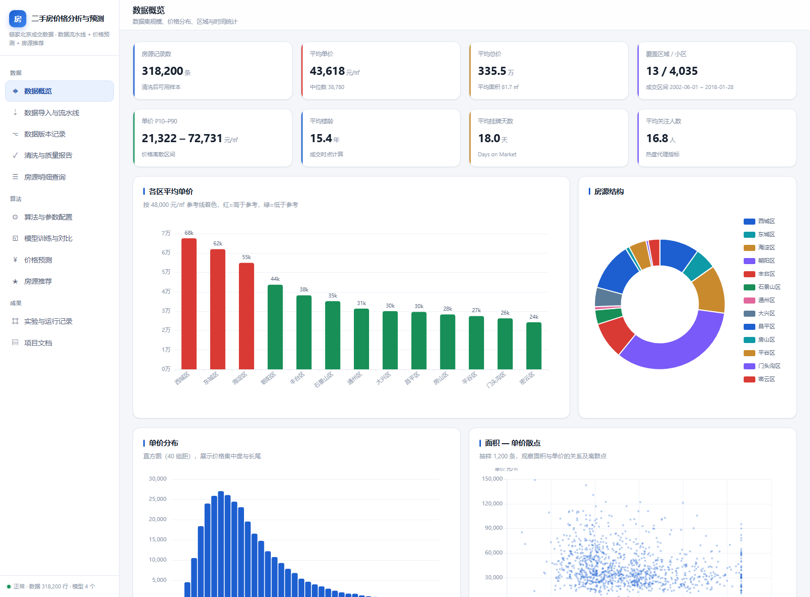</td>
<td width="50%"><b>② 清洗与质量报告</b> — 逐列的缺失填充与异常值修复明细<br>
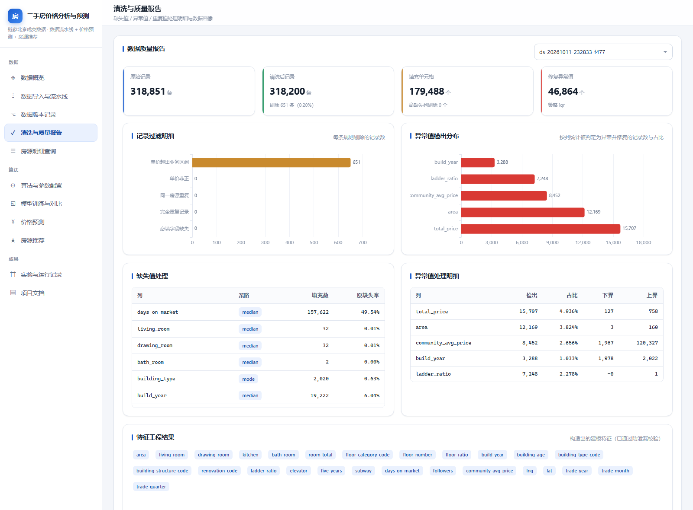</td>
</tr>
<tr>
<td><b>③ 数据导入与流水线</b> — 五组参数可配置，运行日志实时回显<br>
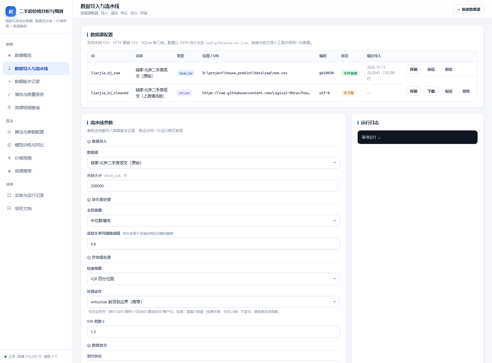</td>
<td><b>④ 数据版本记录</b> — 每次运行的参数、行数变化与 SHA-256 校验和<br>
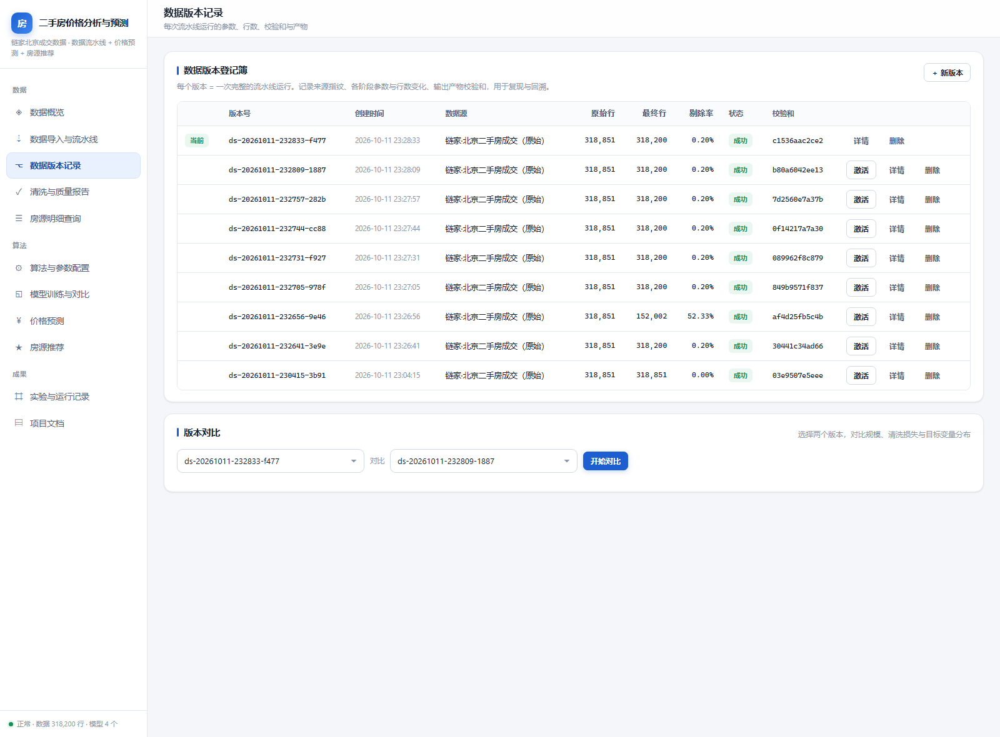</td>
</tr>
<tr>
<td><b>⑤ 模型训练与对比</b> — 4 个模型的真实指标横向对比，最优模型自动标记<br>
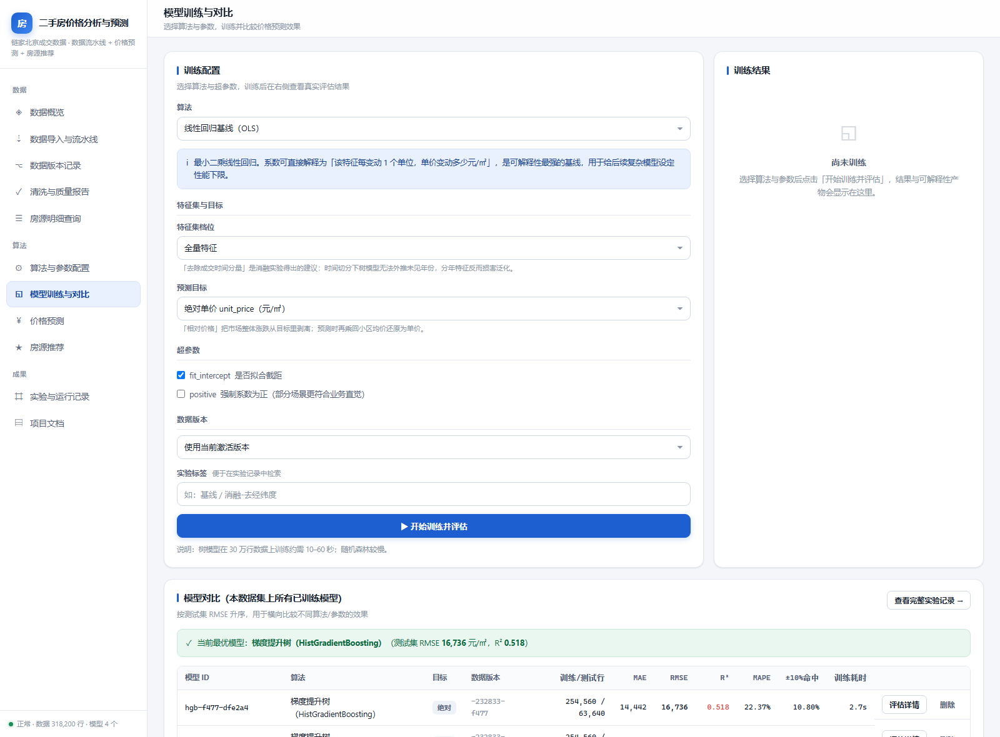</td>
<td><b>⑥ 价格预测</b> — 预测单价 / 总价 / 90% 区间 + 逐特征贡献度归因<br>
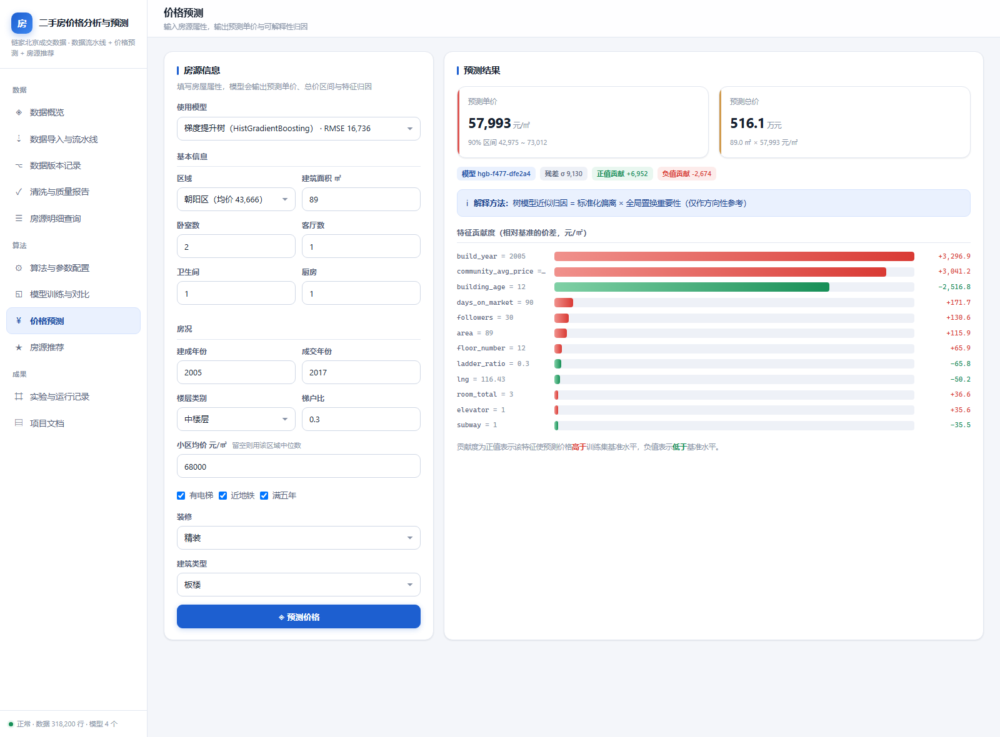</td>
</tr>
<tr>
<td><b>⑦ 房源推荐</b> — Top-K 结果带可读推荐理由，严格遵守用户硬约束<br>
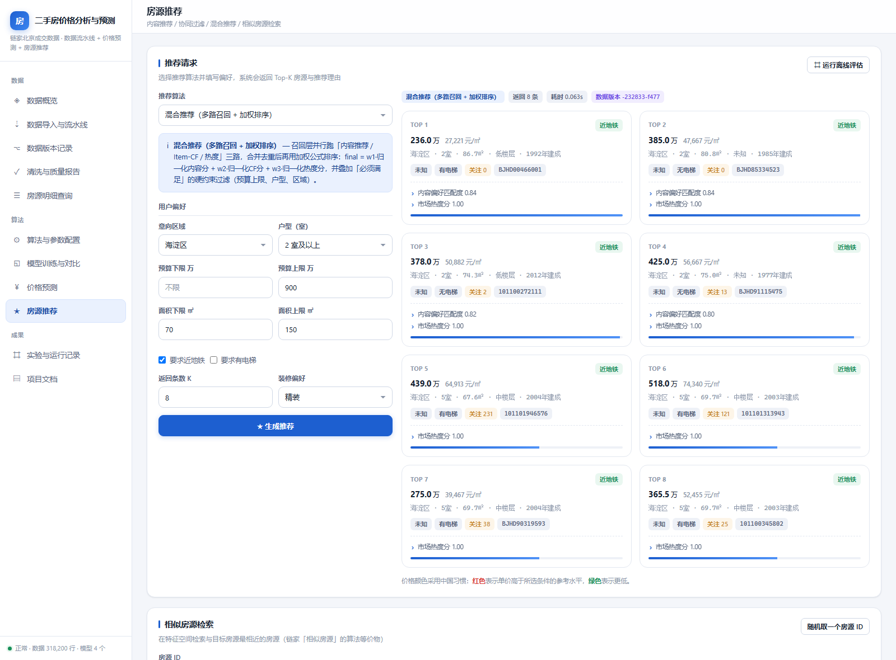</td>
<td><b>⑧ 相似房源检索</b> — 真实数据上的特征空间近邻检索<br>
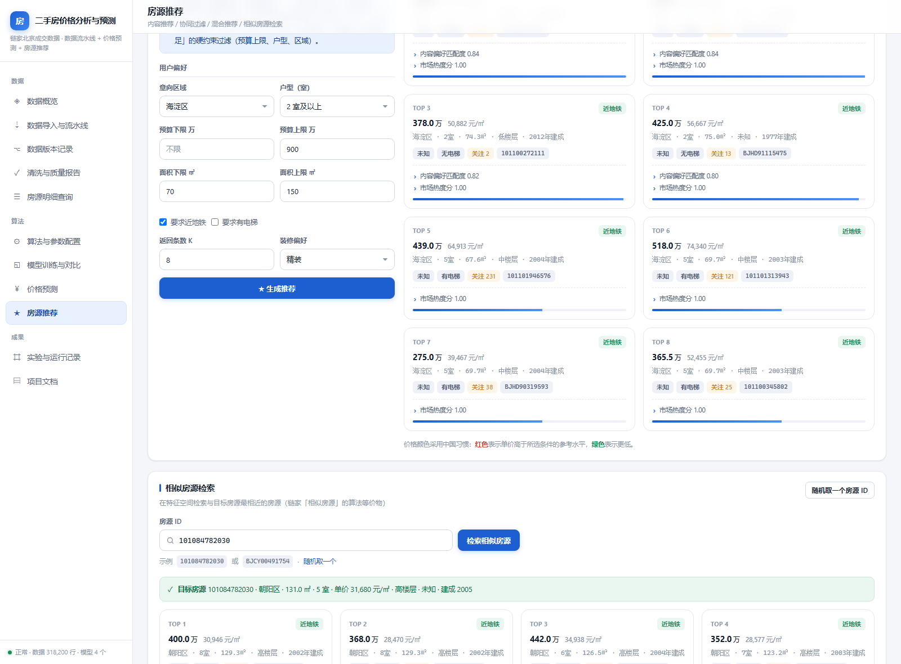</td>
</tr>
<tr>
<td><b>⑨ 算法与参数配置</b> — 9 个算法的输入 / 输出 / 参数 / 评价方法<br>
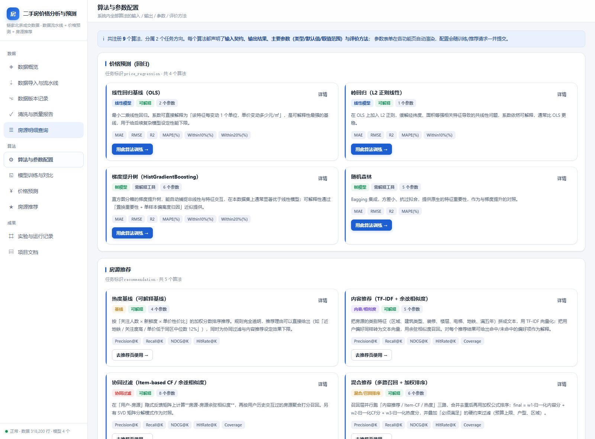</td>
<td><b>⑩ 项目文档</b> — 5 篇 Markdown 文档在线渲染<br>
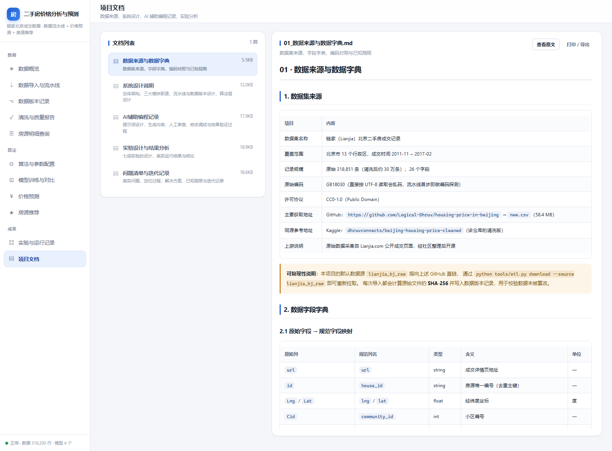</td>
</tr>
<tr>
<td><b>⑪ 房源明细查询</b> — 按区域 / 单价 / 面积 / 户型条件检索 31.8 万条明细<br>
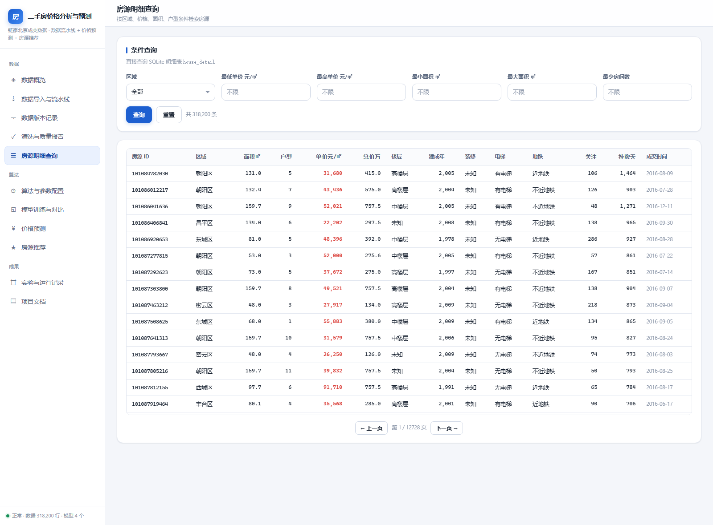</td>
<td><b>⑫ 实验与运行记录</b> — 七组实验的真实运行输出（可展开查看原始 JSON）<br>
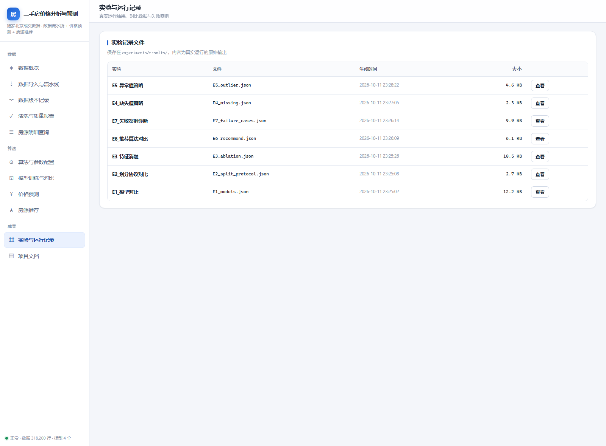</td>
</tr>
</table>

### 从截图里能直接读出的几件事

- **数据是真的**：平均单价 43,618 元/㎡，覆盖 13 个区 / 4,035 个小区，成交区间 2002-06 ~ 2018-01。
- **清洗是真的**：318,851 → 318,200 条，剔除 651 条单价超出业务区间的脏记录；
  补齐 179,488 个缺失单元格、修复 46,864 个异常值，且可逐列核对（`days_on_market` 缺失 49.5% 用中位数填充等）。
- **模型对比是真的**：同一张表里，可解释基线 R²=0.306 / RMSE=20,081，调优后 R²=0.518 / RMSE=16,736
  ——不是单独挑一个好看的数字展示。
- **可解释性是真的**：价格预测给出 57,993 元/㎡、90% 区间 42,975 ~ 73,012，
  并列出 `build_year` / `community_avg_price` / `building_age` 等每个特征的贡献度与方向。
- **推荐可追溯**：每套房源都带「内容偏好匹配度 0.84 / 市场热度分 1.00」这类可读理由；
  界面上填写的预算 ≤900 万、面积 ≥70㎡、2 室及以上、近地铁等约束全部被硬过滤遵守。

> 重新生成截图：`python tools/ui_shot.py`（需先启动服务），输出到 `docs/images/`。
> 全部 12 张原图见 [`docs/images/`](docs/images/)。

---

## 三、功能总览（Web 界面 11 个页面）

| 分组 | 页面 | 说明 |
| --- | --- | --- |
| **数据** | 数据概览 | 数据集规模、单价分布、区域统计、成交趋势、地理分布、特征相关性 |
| | 数据导入与流水线 | 数据源配置（增删改查/探测/下载）、五组流水线参数、运行日志 |
| | 数据版本记录 | 每次运行的参数、行数变化、校验和；支持激活、详情、双版本对比 |
| | 清洗与质量报告 | 缺失值/异常值/重复值处理明细、原始数据画像、特征工程结果 |
| | 房源明细查询 | 按区域、单价、面积、户型条件检索 SQLite 明细表 |
| **算法** | 算法与参数配置 | 9 个算法的输入契约、输出结果、参数表、评价方法、优劣分析 |
| | 模型训练与对比 | 选择算法与超参训练，展示指标、残差分布、重要性、失败案例 |
| | 价格预测 | 输入房源属性 → 预测单价/总价/90% 区间 + 逐特征贡献度归因 |
| | 房源推荐 | 4 种推荐器可选，输出 Top-K 与推荐理由；相似房源检索；离线评估 |
| **成果** | 实验与运行记录 | 七组实验的真实运行结果（模型对比/消融/协议/推荐/失败案例） |
| | 项目文档 | 数据来源、系统设计、AI 辅助编程记录、实验分析、问题清单 |

---

## 四、系统架构

```
浏览器 SPA ──HTTP/JSON──► FastAPI
                             ├── 数据处理模块  /api/sources  /api/pipeline/*  /api/versions/*  /api/listings
                             ├── 核心算法模块  /api/algorithms  /api/models/*  /api/predict  /api/recommend/*
                             └── 结果展示模块  /api/analytics/*  /api/experiments/*  /api/docs/*
                                        │
                     ┌──────────────────┼───────────────────┐
                     ▼                  ▼                   ▼
              数据处理流水线         算法层              存储层
        ingest→clean→features→  价格预测 4 种         SQLite house_detail
        split→store→aggregate   推荐 5 种             Parquet 版本快照
                                评价指标              预聚合 agg_* 表
                                                     版本登记簿 registry/
```

详细设计见 [`docs/02_系统设计说明.md`](docs/02_系统设计说明.md)。

---

## 五、数据处理流水线

| 阶段 | 做的事 | 关键参数 |
| --- | --- | --- |
| ① 导入 | 编码探测（原文件为 GB18030）、列名规范化、**分块流式读取**、类型强制、列级画像 | `chunk_size` |
| ② 清洗 | 记录过滤（必填缺失/重复/目标非正）、取值规范化（编码转中文标签、时间解析）、缺失值处理、异常值处理 | `missing_strategy`、`drop_threshold`、`outlier_strategy`、`iqr_k` |
| ③ 特征 | 楼层解析、户型、楼龄、成交时间分量、到市中心距离、小区均价、类别编码、**防泄漏断言** | 特征白名单 |
| ④ 划分 | 时间切分（默认）或随机切分 | `split_protocol`、`test_size`、`seed` |
| ⑤ 存储 | SQLite 明细表（replace / upsert 增量）+ Parquet 列存快照 + 划分集 | `store_mode` |
| ⑥ 汇总 | 11 类预聚合指标 → SQLite `agg_*` 表 + JSON 快照 | — |

### 数据版本记录
每次运行产出一个版本（`data/registry/<version_id>.json`），记录：来源与文件 SHA-256、
各阶段参数与行数变化、清洗明细、特征清单、划分协议、目标分布、产物校验和。
失败也会留痕（`status="failed"` + traceback）。

### 独立导入 / 更新工具
```bash
python tools/etl.py sources                                  # 列出数据源
python tools/etl.py probe   --source lianjia_bj_raw          # 探测编码与体积
python tools/etl.py download --source lianjia_bj_raw         # 下载
python tools/etl.py split   --source lianjia_bj_raw --rows 100000   # 切分为分片
python tools/etl.py run     --source lianjia_bj_raw --missing median --outlier iqr
python tools/etl.py update  --source lianjia_bj_raw --csv data/raw/new_batch.csv   # 增量更新
python tools/etl.py versions                                 # 查看版本
python tools/etl.py activate --version ds-20261011-224500-a1b2
python tools/etl.py export  --version ds-... --out export.csv
```

---

## 六、核心算法

### 5.1 价格预测（任务：`price_regression`，目标 `unit_price` 元/㎡）

| 算法 ID | 名称 | 可解释 |
| --- | --- | --- |
| `linear_ols` | 线性回归基线（OLS） | ✔ 系数直接可读 |
| `ridge` | 岭回归（标准化空间） | ✔ 标准化系数可读 |
| `hgb` | 直方图梯度提升树 | 置换重要性 + 近似局部归因 |
| `rf` | 随机森林 | Gini 重要性 |

**两个可配置的建模旋钮**（均由消融实验驱动，见 `docs/04`）：

| 旋钮 | 取值 | 说明 |
| --- | --- | --- |
| `feature_profile` | `full` / `no_time` / `no_community` / `compact` | 特征集档位。`no_time` 去除成交时间分量——消融实验发现它会让树模型无法外推未见年份，反而损害泛化 |
| `target_mode` | `absolute` / `relative` | 目标变换。`relative` 预测 `unit_price / community_avg_price`，再乘回小区均价还原为单价 |

**评价方法**：MAE / RMSE / R² / MedAE / MAPE / ±10% 与 ±20% 命中率；同时输出残差分布、
预测值-真实值散点、误差最大的 20 个样本（失败案例）。

**可解释性**：
- 全局 —— 线性模型给系数表；树模型给置换重要性（neg-MAE，5 次重复）
- 局部 —— 逐特征贡献度：线性用 `coef × (x − x̄)`（精确）；树模型用「标准化偏离 × 归一化重要性」（近似，界面标注）
- 不确定性 —— 基于测试集残差标准差的 90% 预测区间

### 5.2 房源推荐（任务：`recommendation`）

| 算法 ID | 名称 | 家族 |
| --- | --- | --- |
| `popularity` | 热度基线（关注度×新鲜度×性价比） | 可解释基线 |
| `content_tfidf` | TF-IDF 内容推荐 + 余弦相似度 | 内容 / 相似度 |
| `item_cf` | Item-based 余弦 / SVD 矩阵分解 | 协同过滤 |
| `hybrid` | 三路召回 + 归一化加权 + 硬约束过滤 | 混合 / 召回排序 |
| `similar_item` | 特征空间近邻检索 | 相似度计算 |

**评价方法**：留一法 + 全量排序下的 Precision@K / Recall@K / NDCG@K / HitRate@K / MAP@K / 覆盖率；
相似房源检索另在**真实数据**上以「同小区 且 单价差 ≤10%」为相关性定义离线评估。

> ⚠️ **关于协同过滤**：公开数据集不含用户 ID，无法构造真实交互矩阵。项目采用**参数化行为模拟日志**
> （用户画像从真实数据分布采样，种子固定、协议公开、完全可复现），并在界面与文档中声明该指标
> 仅用于**算法间相对比较**。真实数据可评估的部分（相似房源检索）单独设协议。

---

## 七、实验设计

```bash
python experiments/run_experiments.py --all
```

| 编号 | 实验 | 目的 |
| --- | --- | --- |
| E1 | 模型对比 | 4 种算法 7 组配置的精度与耗时对比（最优：HGB 去时间 + 调参，R²=0.518 / RMSE=16,736） |
| E2 | 划分协议对比 | 验证随机切分是否高估性能（R² 0.339 → 0.947，证实存在信息泄漏） |
| E3 | 特征消融 | 量化小区均价、地理、时间特征的真实贡献（去掉成交时间分量使树模型 R² +0.168） |
| E4 | 缺失值策略 | median / mean / drop 对最终指标的影响（识别出 drop 策略的样本选择偏差） |
| E5 | 异常值策略 | 5 种策略 × 3 种处置动作的影响（确认不能对目标变量做统计截断） |
| E6 | 推荐算法对比 | 4 种推荐器的离线排序指标 + **真实数据**上的相似房源检索（P@10=0.235） |
| E7 | 失败案例诊断 | 误差最大的样本画像与分价格段/分区域的系统性偏差（测试期整体低估） |

结果保存在 `experiments/results/*.json`，并在 Web 界面「实验与运行记录」页可查看。
完整分析与结论见 [`docs/04_实验设计与结果分析.md`](docs/04_实验设计与结果分析.md)。

### 三个值得注意的实验发现

1. **随机切分把 R² 从 0.339 抬到 0.947，是信息泄漏**——同一小区、同一时期的样本同时进入训练与测试集，
   模型在插值而非预测。本项目默认使用时间切分。
2. **`drop` 缺失值策略让 R² 冲到 0.888 也是假象**——`days_on_market` 在 2011–2014 年缺失 85%，
   删行等于把数据截断到 2015 年后，人为消除了时间漂移（即把外推任务变成了插值任务）。
3. **对目标变量做统计截断等于改标签**——曾把最高的 3.7% 高价成交统一压成 92,477 元/㎡，
   修正后指标从"虚高的 0.209"回到"真实的 0.341"。

---

## 八、数据集

| 项目 | 内容 |
| --- | --- |
| 名称 | 链家（Lianjia）北京二手房成交记录 |
| 规模 | 原始 318,851 条 × 26 字段，成交时间 2011-11 ~ 2017-02，覆盖北京 13 个区 |
| 编码 | GB18030 |
| 许可 | CC0-1.0 (Public Domain) |
| 来源 | GitHub `Logical-Dhruv/housing-price-in-beijing` → `new.csv` |
| 同源参考 | Kaggle `dhruvconnects/beijing-housing-price-cleaned` |

字段字典、编码对照表与数据局限说明见 [`docs/01_数据来源与数据字典.md`](docs/01_数据来源与数据字典.md)。

---

## 九、项目结构

```
house_predict/
├── run.py                        启动脚本
├── requirements.txt
├── backend/
│   ├── main.py                   FastAPI 入口
│   ├── settings.py               路径与运行参数
│   ├── jobs.py                   后台任务队列
│   ├── api/
│   │   ├── routes_pipeline.py    数据处理模块
│   │   ├── routes_algorithm.py   核心算法模块
│   │   └── routes_query.py       结果查询/展示模块
│   ├── pipeline/
│   │   ├── schema.py             列映射与码值字典
│   │   ├── sources.py            数据源配置
│   │   ├── ingest.py             导入（编码探测+分块）
│   │   ├── clean.py              清洗（缺失/异常/重复）
│   │   ├── features.py           特征构造（含防泄漏）
│   │   ├── split.py              数据划分
│   │   ├── store.py              存储与批处理汇总
│   │   ├── versioning.py         数据版本管理
│   │   └── runner.py             流水线编排
│   ├── algorithms/
│   │   ├── registry.py           算法注册表
│   │   ├── price_models.py       价格预测 4 种算法
│   │   ├── recommend.py          推荐 5 种算法
│   │   ├── metrics.py            回归/排序指标
│   │   └── trainer.py            训练与推理编排
│   └── web/                      前端（原生 ES + ECharts + marked）
│       ├── index.html
│       ├── app.js                单页应用（11 个页面）
│       ├── style.css             设计系统
│       └── vendor/               本地化的 echarts / marked（离线可用）
├── tools/
│   ├── etl.py                    独立数据导入/更新工具（CLI）
│   └── ui_shot.py                UI 截图工具（CDP 驱动，生成 README 配图）
├── experiments/                  实验脚本 + 结果
├── data/                         raw / processed / registry / models / reports / house.db
├── config/datasources.json       数据源配置
└── docs/
    ├── 01~05_*.md                项目文档（5 篇）
    └── images/                   README 与文档引用的界面截图
```

---

## 十、API 速查

| 方法 | 路径 | 说明 |
| --- | --- | --- |
| GET | `/api/health` | 服务状态 |
| GET/POST/DELETE | `/api/sources` | 数据源配置 |
| POST | `/api/sources/{id}/probe`、`/download`、`/split` | 探测 / 下载 / 切片 |
| POST | `/api/pipeline/run` | 运行数据流水线（异步返回 `job_id`） |
| GET | `/api/versions`、`/api/versions/{id}`、`/quality` | 数据版本 |
| POST | `/api/versions/{id}/activate` | 激活版本 |
| GET | `/api/analytics/overview`、`/district`、`/trend`、`/distribution`、`/correlation`、`/scatter`、`/geo`、`/compare` | 统计与图表数据 |
| GET | `/api/listings` | 房源明细条件查询 |
| GET | `/api/algorithms`、`/api/algorithms/{id}` | 算法注册表 |
| POST | `/api/models/train` | 训练价格模型（异步） |
| POST | `/api/models/{id}/predict`、`/api/predict` | 价格预测（含归因） |
| POST | `/api/recommend`、`/recommend/similar`、`/recommend/evaluate` | 推荐 / 相似房源 / 离线评估 |
| GET | `/api/jobs/{id}` | 任务状态 |
| GET | `/api/experiments`、`/api/docs` | 实验记录、项目文档 |

完整交互式接口文档：启动服务后访问 `http://127.0.0.1:8000/docs`（Swagger UI）。

---

## 十一、文档索引

| 文档 | 内容 |
| --- | --- |
| [`docs/01_数据来源与数据字典.md`](docs/01_数据来源与数据字典.md) | 数据来源、字段字典、编码对照、数据局限 |
| [`docs/02_系统设计说明.md`](docs/02_系统设计说明.md) | 架构、三大模块、流水线、版本记录、算法设计 |
| [`docs/03_AI辅助编程记录.md`](docs/03_AI辅助编程记录.md) | 提示词设计、生成内容、人工审查、修改调试、效果验证 |
| [`docs/04_实验设计与结果分析.md`](docs/04_实验设计与结果分析.md) | 七组实验的设计、真实运行结果与结论 |
| [`docs/05_问题清单与迭代记录.md`](docs/05_问题清单与迭代记录.md) | 真实问题、定位过程、解决方案、已知局限、迭代记录 |

---

## 十二、使用声明

数据集为公开、CC0 许可的历史成交记录（2011–2017），仅用于教学与算法研究。
本项目不对数据准确性作担保，**不得用于商业定价或投资决策**。
